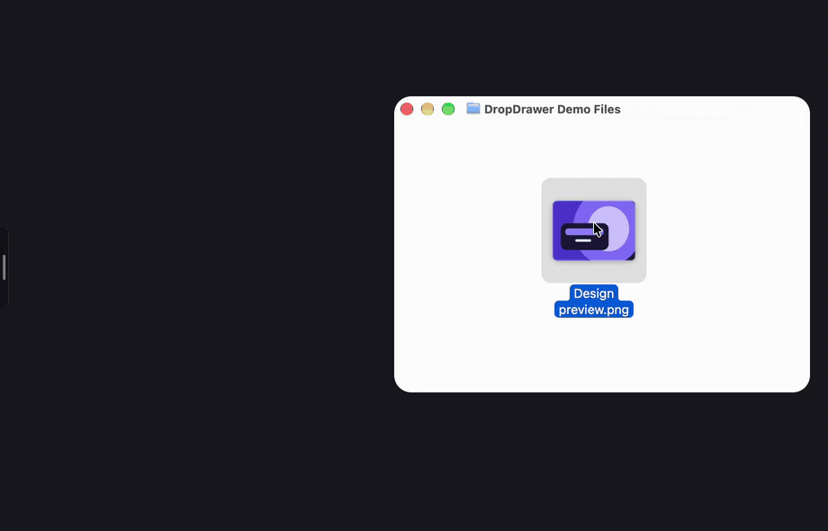
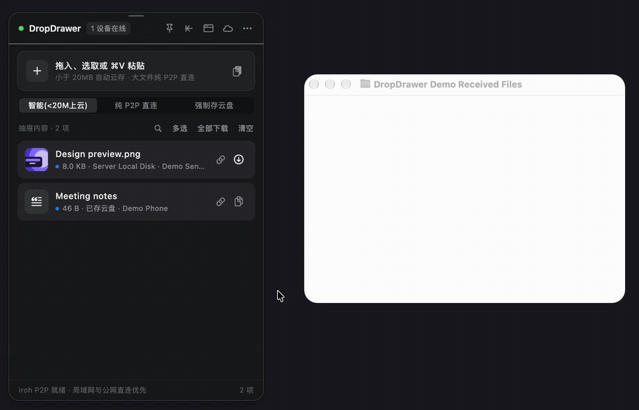
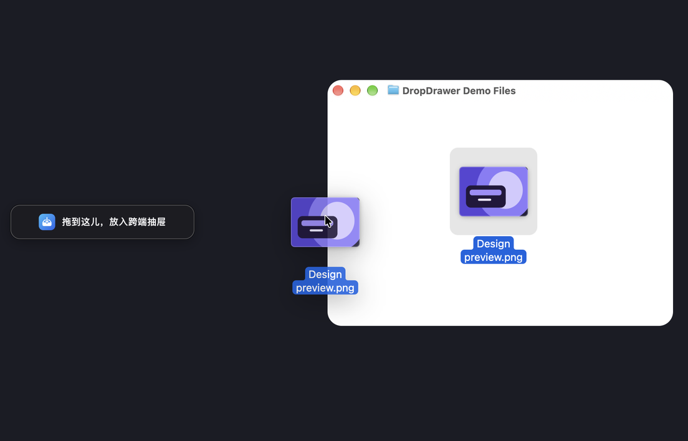
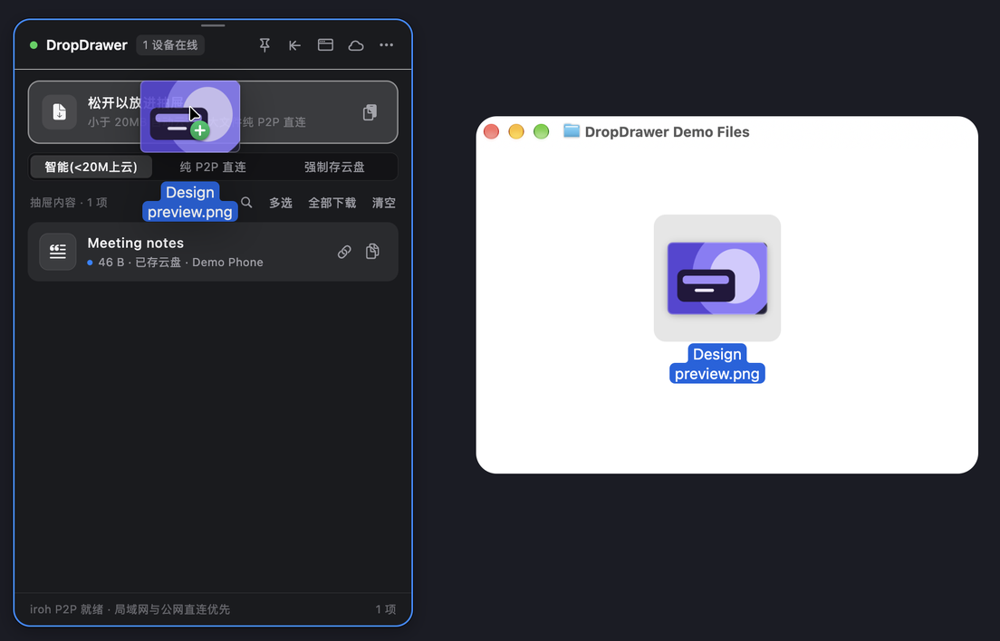
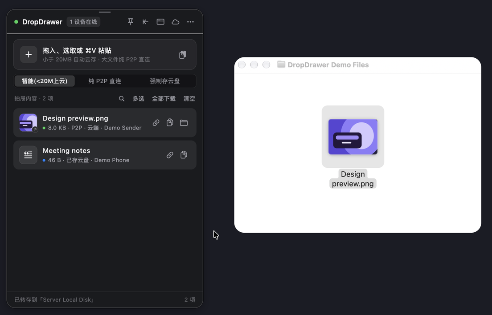
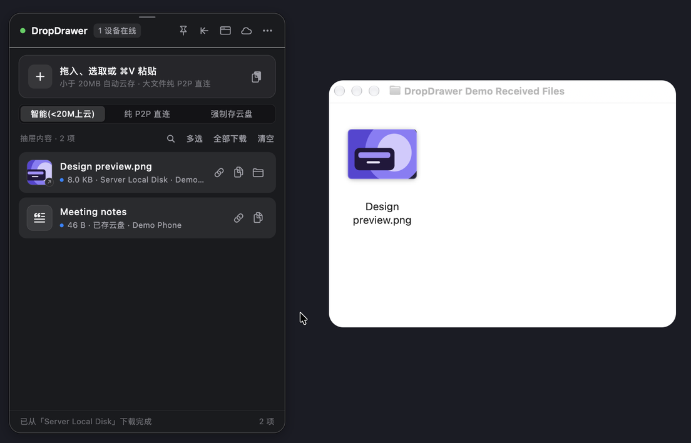
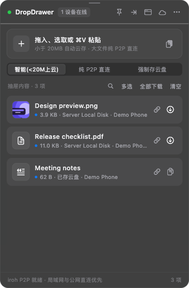
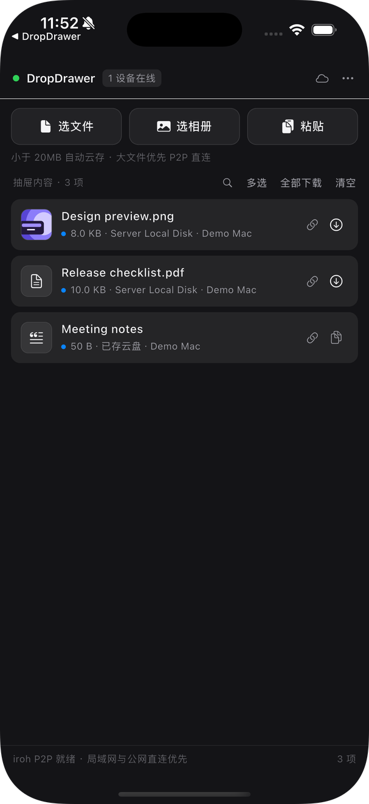

<p align="center">
  
</p>

<h1 align="center">DropDrawer</h1>

<p align="center"><strong>画面端のドロワーにファイルを入れて、別のデバイスで取り出せます。</strong></p>

<p align="center">
  <a href="README.md">English</a> |
  <a href="README.zh-CN.md">简体中文</a> |
  <a href="README.zh-TW.md">繁體中文</a> |
  日本語 |
  <a href="README.ko.md">한국어</a>
</p>

<p align="center">
  <a href="https://github.com/StackTao/DropDrawer/releases"></a>
  <a href="https://github.com/StackTao/DropDrawer/actions/workflows/windows-installer.yml"></a>
  <a href="https://github.com/StackTao/DropDrawer/actions/workflows/android-apk.yml"></a>
  <a href="https://github.com/StackTao/DropDrawer/releases"></a>
  <a href="https://github.com/StackTao/DropDrawer/stargazers"></a>
  <a href="LICENSE"></a>
</p>

<p align="center">
  <a href="#操作デモ">操作デモ</a> ·
  <a href="https://github.com/StackTao/DropDrawer/releases">ダウンロード</a> ·
  <a href="#クライアントのインストール">インストール</a> ·
  <a href="#サーバーをセルフホストする">セルフホスト</a> ·
  <a href="docs/ARCHITECTURE.md">アーキテクチャ（中国語）</a> ·
  <a href="https://github.com/StackTao/DropDrawer/issues">問題の報告</a> ·
  <a href="LICENSE">MIT License</a>
</p>

DropDrawer は、ファイルを転送・一時保管できるセルフホスト対応のクロスプラットフォームアプリです。デスクトップ版では画面端のドロワーを使い、モバイル版でもファイル、写真、テキストを送受信できます。両方のデバイスがオンラインのときは、まず P2P の直接接続を試みます。送信元がオフラインでも、設定したストレージにキャッシュ済みのファイルは取得できます。ブラウザーでダウンロードできる共有リンクも作成できます。

## 操作デモ

**ドラッグしてアップロード.** Finder からファイルを画面端に向かってドラッグします。ドロワーが開いたら、強調表示された領域にドロップしてください。クラウドキャッシュが有効なら、アップロード後に別のデバイスでも取得できます。



**別のデバイスで受け取る.** 同じアカウントでログインし、同期されたファイルの横にあるダウンロードボタンを押します。GIF では、保存したファイルが受信側の Finder フォルダに表示されます。



<details>
<summary>デスクトップ版の手順を画像で見る</summary>

1. ファイルをドラッグすると、画面端にガイドが表示されます。

   

2. ドロワーが開き、ドロップ先が強調表示されます。

   

3. アップロードが完了すると、ファイルがドロワーに追加されます。

   

4. ダウンロードしたファイルが受信側のフォルダに表示されます。

   

**展開したデスクトップ版ドロワー**

<p align="center">
  
</p>

</details>

### iPhone 版

ファイルや写真をすぐに選択したり、クリップボードから貼り付けたりできます。その下には、ダウンロードや共有ができる同期済みの項目が並びます。

<p align="center">
  
</p>

## 主な機能

- **画面端のドロワー**。macOS と Windows では、ファイルをドラッグして出し入れしたり、ドロワーを別のディスプレイに移したりできます。グローバルショートカット、クリップボードからの貼り付け、画像プレビューに対応し、通常のウィンドウにも切り替えられます。
- **モバイルでの送受信**。Android と iOS では、ファイルや写真の選択、貼り付け、システムの共有機能による送信、画像の写真ライブラリへの保存ができます。Android では共有メニューから、iOS では「DropDrawer で開く」からファイルを取り込めます。
- **P2P を優先**。iroh QUIC を使用し、LAN またはインターネット経由で直接接続を試みます。必要な場合は暗号化リレーを使用します。中断した転送の再開、BLAKE3 による整合性チェック、受信完了通知、両端末からのキャンセルに対応しています。
- **セルフホストとオフライン時の取得**。Rust 製のサーバーがアカウント、デバイスのオンライン状態、ドロワーの同期を管理します。Google Drive、Quark Drive、Baidu Netdisk、S3 互換ストレージ（Cloudflare R2 を含む）、WebDAV、サーバーのローカルディスクを利用できます。
- **リンクで共有**。ファイルを単体で共有したり、複数まとめてダウンロードできるようにしたりできます。受信者はブラウザーからダウンロードできます。パスコード、有効期限、ダウンロード回数の上限を設定でき、リンクはいつでも無効化できます。

## クライアントのインストール

| プラットフォーム | インストーラーまたはビルド方法 |
| --- | --- |
| macOS（Apple silicon） | [macOS パッケージ作成スクリプト](scripts/build_macos_release.sh)で `dist/DropDrawer-macOS.dmg` を作成します。DMG を開き、DropDrawer を「アプリケーション」にドラッグしてください。 |
| Windows（x64） | 成功した [Windows installer](https://github.com/StackTao/DropDrawer/actions/workflows/windows-installer.yml) の実行結果から `DropDrawer-Windows-x64` をダウンロードし、展開してインストーラーを実行します。 |
| Android | 成功した [Android APK](https://github.com/StackTao/DropDrawer/actions/workflows/android-apk.yml) の実行結果から `DropDrawer-Android-APK` をダウンロードし、展開して対象の APK をインストールします。 |
| iOS | macOS 上で Flutter と Xcode を使い、[ソースからビルド](#ソースからビルド)します。実機へのインストールにはコード署名が必要です。 |

Windows と Android のビルド成果物は 30 日間保存されます。権限のあるリポジトリメンバーは、ワークフローを手動で実行して新しいインストーラーを作成できます。

### はじめての転送

1. 両方のデバイスからアクセスできる [DropDrawer サーバー](#サーバーをセルフホストする)を起動します。
2. 両方のデバイスで同じサーバーアドレスを入力し、作成したアカウントでログインします。
3. デスクトップではドロワーにファイルをドラッグし、モバイルではファイルを選択します。もう一方のデバイスでドロワーを開いてダウンロードします。

送信元がオフラインの間にもファイルをダウンロードするには、クラウドキャッシュを有効にし、選択したストレージへのアップロードが完了していることを確認してください。

## サーバーをセルフホストする

リポジトリのルートで Docker Compose または Cargo を実行します。Docker Compose ではデータは既定で `deploy/data/server` に保存されます。サーバーを直接実行する場合は `./data` を使用します。

```bash
cp -n .env.example .env
docker compose --env-file .env -f deploy/docker-compose.yml up -d --build

curl -fsS http://localhost:8080/health
```

ローカル開発には `cargo run --bin dropdrawer-server` も使えます。同じ LAN 上にある別のデバイスでは、`http://192.168.1.10:8080` のように、サーバーを実行しているホストのアドレスを入力します。

`DROPDRAWER_JWT_SECRET` を設定しない場合、サーバーは初回起動時にランダムなシークレットを生成し、データベースと同じ場所の `jwt_secret` に保存します。十分に長いランダムな値を自分で設定することもできます。必要なアカウントをすべて作成したら、`DROPDRAWER_ALLOW_REGISTRATION=false` を設定して新規登録を停止してください。本番環境では、WebSocket のアップグレードに対応する HTTPS リバースプロキシも必要です。大きなファイルを転送する場合はプロキシのバッファリングを無効にし、アップロードサイズの上限を環境に合わせて調整してください。共有リンクを受け取った人も、サーバーにアクセスできる必要があります。[本番用 Compose テンプレート](deploy/compose.baota.yml) · [アーキテクチャ（中国語）](docs/ARCHITECTURE.md)

[Google ログインの設定ガイド](docs/GOOGLE_SIGN_IN.md)に沿って Google ログインを有効にできます。各端末で同じ Google アカウントを使うと、同じドロワーにアクセスできます。

## ソースからビルド

Rust と Flutter の安定版を用意してください。macOS と iOS のビルドには Xcode が必要です。Windows と Android は、上記の GitHub Actions ワークフローを利用できます。

### macOS

```bash
./scripts/build_macos_p2p.sh
(cd app && flutter pub get --enforce-lockfile && flutter run -d macos)
```

`./scripts/build_macos_release.sh` で DMG を作成できます。`--install` を付けると、「アプリケーション」内の DropDrawer を更新します。グローバルショートカットを使う場合は、必要に応じて「アクセシビリティ」と「入力監視」の権限を許可してください。

### iOS

```bash
./scripts/build_ios_p2p.sh
(cd app && flutter pub get --enforce-lockfile && flutter build ios --simulator --no-codesign)
```

実機で動作を確認するには、Xcode で `app/ios/Runner.xcworkspace` を開き、署名を設定してから実行します。

## プロジェクト構成とコントリビュート

| パス | 内容 |
| --- | --- |
| [app](app) | Flutter クライアントと macOS、Windows、iOS、Android のネイティブ連携 |
| [crates/server](crates/server) | Axum、SQLite、WebSocket、ストレージアダプター、共有リンクからのダウンロード |
| [crates/p2p-core](crates/p2p-core) | iroh QUIC 転送エンジンとネイティブ FFI |
| [crates/protocol](crates/protocol) · [crates/p2p-cli](crates/p2p-cli) | 共通プロトコルと P2P デバッグツール |
| [deploy](deploy) · [scripts](scripts) | コンテナデプロイ、インストーラー、各プラットフォームのビルドスクリプト |

バグ報告や機能の提案は [GitHub Issues](https://github.com/StackTao/DropDrawer/issues) へお願いします。バグ報告にはプラットフォーム、バージョン、再現手順を記載してください。コードを提出する前に、[開発ガイド（中国語）](AGENTS.md)に沿って関連するチェックを実行してください。

```bash
cargo test --workspace
(cd app && flutter analyze && flutter test)
```

P2P の動作だけを確認するには、`cargo run --bin dropdrawer-p2p-cli -- seed ./sample.zip` で転送チケットを発行し、受信側で `cargo run --bin dropdrawer-p2p-cli -- pull '<TICKET_JSON>' ./received.zip` を実行してください。

コミュニティでの交流には [LINUX DO](https://linux.do/) をご利用ください。

## スター数の推移

<a href="https://www.star-history.com/?repos=StackTao%2FDropDrawer&amp;type=date">
  <picture>
    <source media="(prefers-color-scheme: dark)" srcset="https://api.star-history.com/svg?repos=StackTao/DropDrawer&amp;type=Date&amp;theme=dark" />
    
  </picture>
</a>

## ライセンス

DropDrawer は [MIT License](LICENSE) のもとで配布されています。
