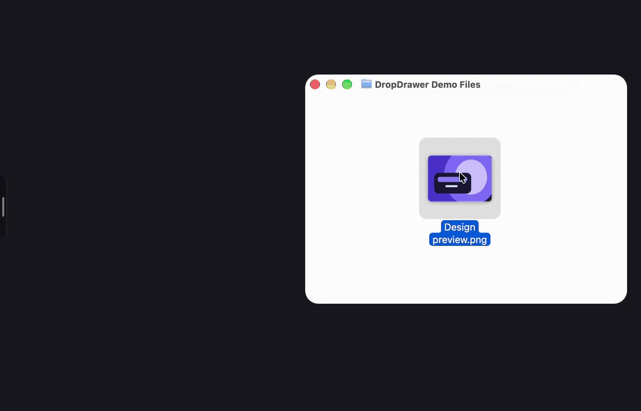
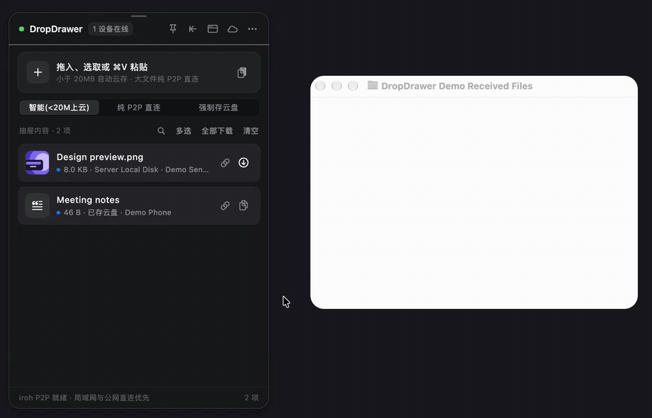
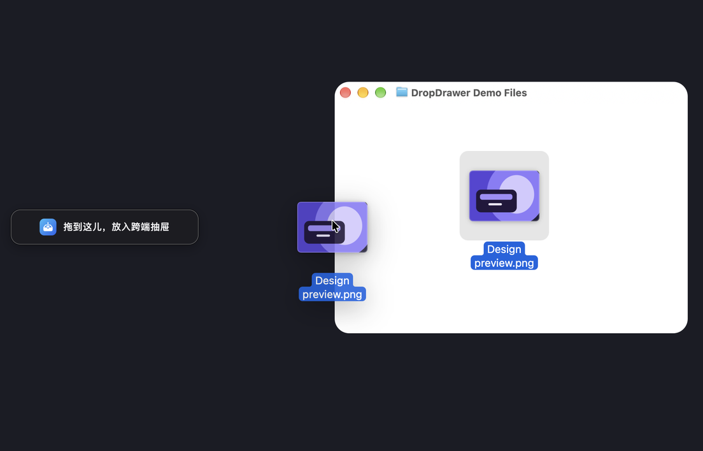
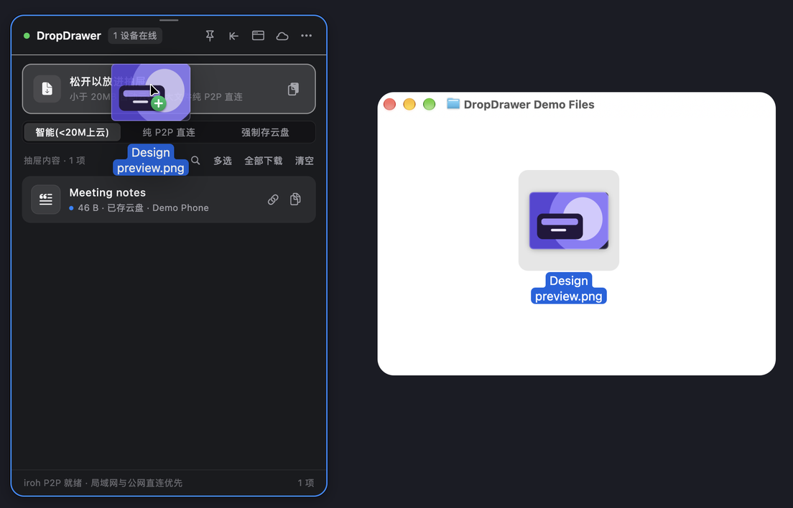
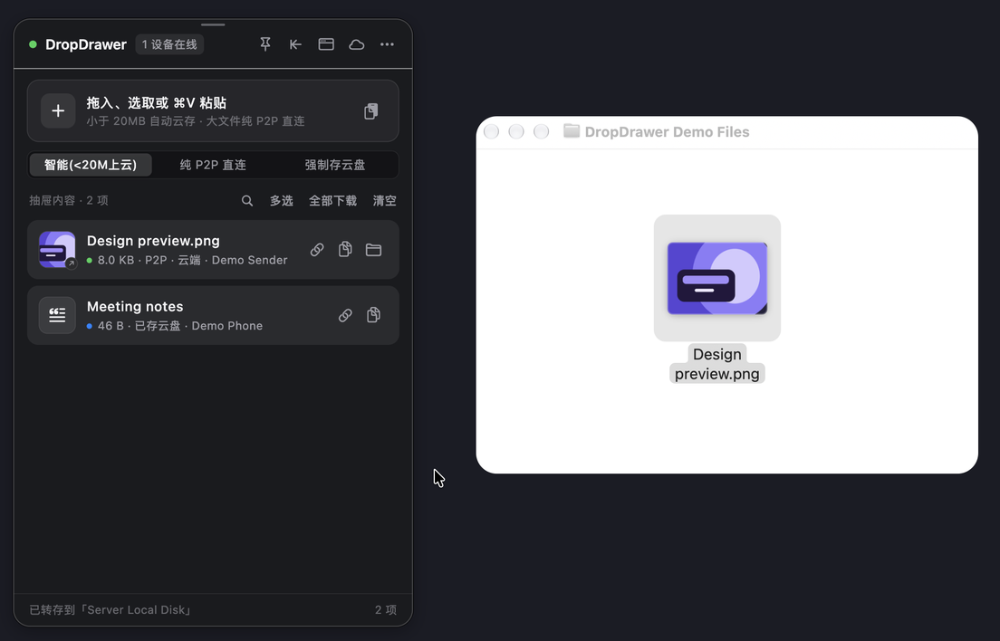
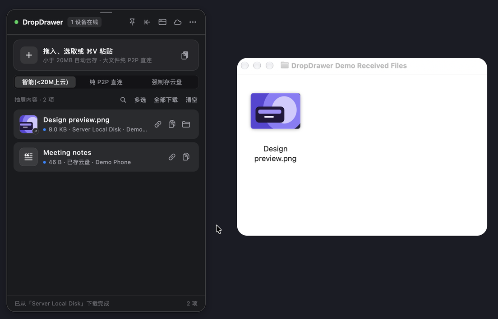
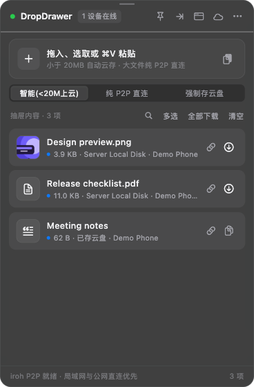
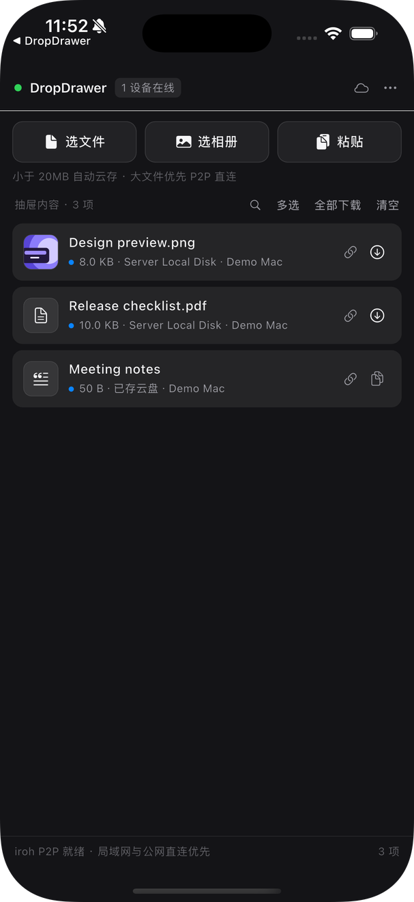

<p align="center">
  
</p>

<h1 align="center">DropDrawer</h1>

<p align="center"><strong>화면 가장자리의 서랍에 파일을 넣고 다른 기기에서 꺼내세요.</strong></p>

<p align="center">
  <a href="README.md">English</a> |
  <a href="README.zh-CN.md">简体中文</a> |
  <a href="README.zh-TW.md">繁體中文</a> |
  <a href="README.ja.md">日本語</a> |
  한국어
</p>

<p align="center">
  <a href="https://github.com/StackTao/DropDrawer/releases"></a>
  <a href="https://github.com/StackTao/DropDrawer/actions/workflows/windows-installer.yml"></a>
  <a href="https://github.com/StackTao/DropDrawer/actions/workflows/android-apk.yml"></a>
  <a href="https://github.com/StackTao/DropDrawer/releases"></a>
  <a href="https://github.com/StackTao/DropDrawer/stargazers"></a>
  <a href="LICENSE"></a>
</p>

<p align="center">
  <a href="#사용-예시">사용 예시</a> ·
  <a href="https://github.com/StackTao/DropDrawer/releases">다운로드</a> ·
  <a href="#클라이언트-설치">설치</a> ·
  <a href="#서버-자체-호스팅">자체 호스팅</a> ·
  <a href="docs/ARCHITECTURE.md">아키텍처 (중국어)</a> ·
  <a href="https://github.com/StackTao/DropDrawer/issues">문제 신고</a> ·
  <a href="LICENSE">MIT License</a>
</p>

DropDrawer는 파일을 전송하고 임시로 보관하는 자체 호스팅 지원 크로스 플랫폼 앱입니다. 데스크톱에서는 화면 가장자리의 서랍을 열어 파일을 관리하고, 모바일에서는 파일, 사진, 텍스트를 주고받을 수 있습니다. 두 기기가 모두 온라인이면 먼저 P2P 직접 연결을 시도합니다. 보낸 기기가 오프라인이어도 설정한 저장소에 캐시된 파일은 내려받을 수 있습니다. 브라우저에서 다운로드할 수 있는 공유 링크도 만들 수 있습니다.

## 사용 예시

**파일을 끌어 넣고 업로드하기.** Finder에서 파일을 화면 가장자리로 끌어갑니다. 서랍이 열리면 강조 표시된 영역에 놓습니다. 클라우드 캐시가 켜져 있으면 업로드한 파일을 다른 기기에서도 받을 수 있습니다.



**다른 기기에서 받기.** 같은 계정으로 로그인하고 동기화된 파일 옆의 다운로드 버튼을 누릅니다. GIF에서는 받은 파일이 수신 기기의 Finder 폴더에 나타납니다.



<details>
<summary>데스크톱 단계별 스크린샷 보기</summary>

1. 파일을 끌면 화면 가장자리에 안내가 나타납니다.

   

2. 서랍이 열리고 파일을 놓을 영역이 강조됩니다.

   

3. 업로드가 끝나면 새 파일이 서랍 목록에 표시됩니다.

   

4. 다운로드한 파일이 받는 기기의 폴더에 표시됩니다.

   

**펼친 데스크톱 서랍**

<p align="center">
  
</p>

</details>

### iPhone에서 사용하기

파일이나 사진을 빠르게 선택하거나 클립보드에서 붙여넣을 수 있습니다. 아래에 표시되는 동기화 항목은 바로 내려받거나 공유할 수 있습니다.

<p align="center">
  
</p>

## 주요 기능

- **데스크톱 화면 가장자리 서랍**. macOS와 Windows에서 파일을 서랍에 끌어 넣거나 다른 앱으로 끌어낼 수 있습니다. 서랍을 다른 모니터로 옮기고, 전역 단축키로 열고, 클립보드에서 붙여넣고, 이미지를 미리 볼 수 있습니다. 일반 창으로 전환하는 기능도 지원합니다.
- **모바일 전송**. Android와 iOS에서 파일이나 사진을 선택하거나, 콘텐츠를 붙여넣거나, 시스템 공유 기능으로 보낼 수 있습니다. 사진 보관함에 이미지를 저장할 수도 있습니다. Android에서는 시스템 공유 메뉴로, iOS에서는 ‘DropDrawer에서 열기’로 파일을 가져올 수 있습니다.
- **P2P 우선**. iroh QUIC으로 로컬 네트워크나 인터넷에서 직접 연결을 먼저 시도합니다. 필요하면 암호화된 릴레이를 사용합니다. 중단된 전송 이어받기, BLAKE3 무결성 검사, 수신 완료 확인, 양쪽 기기에서의 취소를 지원합니다.
- **자체 호스팅과 오프라인 접근**. Rust 서버가 계정, 기기 접속 상태, 서랍 동기화를 관리합니다. Google Drive, Quark Drive, Baidu Netdisk, S3 호환 저장소(Cloudflare R2 포함), WebDAV, 서버의 로컬 디스크를 사용할 수 있습니다.
- **링크 공유**. 파일 하나를 공유하거나 여러 파일을 묶어서 공유할 수 있습니다. 받는 사람은 브라우저에서 다운로드할 수 있습니다. 암호, 만료 시간, 다운로드 횟수 제한을 설정하거나 링크를 언제든지 해제할 수 있습니다.

## 클라이언트 설치

| 플랫폼 | 설치 파일 또는 빌드 방법 |
| --- | --- |
| macOS (Apple silicon) | [macOS 패키징 스크립트](scripts/build_macos_release.sh)로 `dist/DropDrawer-macOS.dmg`를 만듭니다. DMG를 열고 DropDrawer를 응용 프로그램 폴더로 끌어다 놓으세요. |
| Windows (x64) | 성공한 [Windows installer](https://github.com/StackTao/DropDrawer/actions/workflows/windows-installer.yml) 실행에서 `DropDrawer-Windows-x64` 빌드 결과물을 다운로드합니다. 압축을 풀고 설치 프로그램을 실행하세요. |
| Android | 성공한 [Android APK](https://github.com/StackTao/DropDrawer/actions/workflows/android-apk.yml) 실행에서 `DropDrawer-Android-APK` 빌드 결과물을 다운로드합니다. 압축을 풀고 해당 APK를 설치하세요. |
| iOS | macOS에서 Flutter와 Xcode로 [소스에서 빌드](#소스에서-빌드)합니다. 실제 기기에 설치하려면 코드 서명이 필요합니다. |

Windows와 Android 빌드 결과물은 30일 동안 보관됩니다. 권한이 있는 저장소 구성원은 워크플로를 수동으로 실행해 새 설치 파일을 만들 수 있습니다.

### 첫 번째 파일 전송

1. 두 기기 모두에서 접속할 수 있는 [DropDrawer 서버](#서버-자체-호스팅)를 실행합니다.
2. 두 기기에서 같은 서버 주소를 입력합니다. 계정을 만든 다음 두 기기에서 그 계정으로 로그인합니다.
3. 데스크톱에서는 파일을 서랍에 끌어 넣고, 모바일에서는 파일을 선택합니다. 다른 기기에서 서랍을 열어 파일을 내려받습니다.

보낸 기기가 오프라인일 때도 파일을 받으려면 클라우드 캐시를 켜고 선택한 저장소에 업로드가 완료됐는지 확인하세요.

## 서버 자체 호스팅

저장소 루트에서 Docker Compose 또는 Cargo를 실행합니다. Docker Compose는 기본적으로 `deploy/data/server`에 데이터를 저장합니다. 서버를 직접 실행하면 `./data`를 사용합니다.

```bash
cp -n .env.example .env
docker compose --env-file .env -f deploy/docker-compose.yml up -d --build

curl -fsS http://localhost:8080/health
```

로컬 개발에는 `cargo run --bin dropdrawer-server`를 사용할 수 있습니다. 같은 로컬 네트워크의 다른 기기에서는 `http://192.168.1.10:8080`처럼 서버를 실행하는 호스트의 주소를 입력하세요.

`DROPDRAWER_JWT_SECRET`을 설정하지 않으면 서버가 처음 시작할 때 무작위 비밀 값을 생성해 데이터베이스 옆의 `jwt_secret` 파일에 저장합니다. 충분히 긴 무작위 값을 직접 설정할 수도 있습니다. 필요한 계정을 모두 만든 뒤에는 `DROPDRAWER_ALLOW_REGISTRATION=false`로 새 가입을 막으세요. 운영 환경에서는 WebSocket 업그레이드를 지원하는 HTTPS 리버스 프록시도 필요합니다. 대용량 파일을 전송할 때는 프록시 버퍼링을 끄고 환경에 맞게 업로드 크기 제한을 조정하세요. 공유 링크를 받은 사람도 서버에 접속할 수 있어야 합니다. [운영용 Compose 템플릿](deploy/compose.baota.yml) · [아키텍처 (중국어)](docs/ARCHITECTURE.md)

[Google 로그인 설정 가이드](docs/GOOGLE_SIGN_IN.md)에 따라 Google 로그인을 활성화할 수 있습니다. 모든 기기에서 같은 Google 계정으로 로그인하면 같은 서랍에 접근할 수 있습니다.

### 관리 콘솔

`DROPDRAWER_ADMIN_TOKEN`을 설정한 뒤 서버의 `/admin`을 열면 사용자, 저장소, 로그인, 보존 기간, 공유 정책을 관리할 수 있습니다. 관리자 토큰, SMTP, 저장소 할당량, Google 로그인 및 리버스 프록시 설정은 [서버 환경 변수(중국어)](docs/CONFIGURATION.md)에서 확인하세요.

## 소스에서 빌드

Rust와 Flutter의 안정 버전을 설치하세요. macOS와 iOS를 빌드하려면 Xcode가 필요합니다. Windows와 Android는 위에 있는 GitHub Actions 워크플로를 사용할 수 있습니다.

### macOS

```bash
./scripts/build_macos_p2p.sh
(cd app && flutter pub get --enforce-lockfile && flutter run -d macos)
```

`./scripts/build_macos_release.sh`를 실행해 DMG를 만듭니다. `--install`을 추가하면 응용 프로그램 폴더의 DropDrawer를 업데이트합니다. 전역 단축키를 사용하려면 시스템 안내에 따라 손쉬운 사용 및 입력 모니터링 권한을 허용하세요.

### iOS

```bash
./scripts/build_ios_p2p.sh
(cd app && flutter pub get --enforce-lockfile && flutter build ios --simulator --no-codesign)
```

실제 기기에서 실행하려면 Xcode에서 `app/ios/Runner.xcworkspace`를 열고 서명을 설정하세요.

## 프로젝트 구조 및 기여

| 경로 | 역할 |
| --- | --- |
| [app](app) | Flutter 클라이언트와 macOS, Windows, iOS, Android 네이티브 연동 |
| [crates/server](crates/server) | Axum, SQLite, WebSocket, 저장소 어댑터, 공유 링크 다운로드 |
| [crates/p2p-core](crates/p2p-core) | iroh QUIC 전송 엔진 및 네이티브 FFI |
| [crates/protocol](crates/protocol) · [crates/p2p-cli](crates/p2p-cli) | 공통 프로토콜과 P2P 디버깅 도구 |
| [deploy](deploy) · [scripts](scripts) | 컨테이너 배포, 설치 파일, 플랫폼별 빌드 스크립트 |

버그를 발견했거나 기능을 제안하려면 [GitHub Issues](https://github.com/StackTao/DropDrawer/issues)를 이용하세요. 버그를 신고할 때는 플랫폼, 버전, 재현 단계를 적어 주세요. 코드를 제출하기 전에 [개발 가이드 (중국어)](AGENTS.md)에 따라 관련 검사를 실행하세요.

```bash
cargo test --workspace
(cd app && flutter analyze && flutter test)
```

P2P 전송을 따로 확인하려면 `cargo run --bin dropdrawer-p2p-cli -- seed ./sample.zip`을 실행해 전송 티켓을 생성합니다. 받는 기기에서는 `cargo run --bin dropdrawer-p2p-cli -- pull '<TICKET_JSON>' ./received.zip`을 실행합니다.

[LINUX DO](https://linux.do/) 커뮤니티에서 이야기를 나눠 보세요.

## 스타 수 추이

<a href="https://www.star-history.com/?repos=StackTao%2FDropDrawer&amp;type=date">
  <picture>
    <source media="(prefers-color-scheme: dark)" srcset="https://api.star-history.com/svg?repos=StackTao/DropDrawer&amp;type=Date&amp;theme=dark" />
    
  </picture>
</a>

## 라이선스

DropDrawer는 [MIT License](LICENSE)를 따릅니다.
