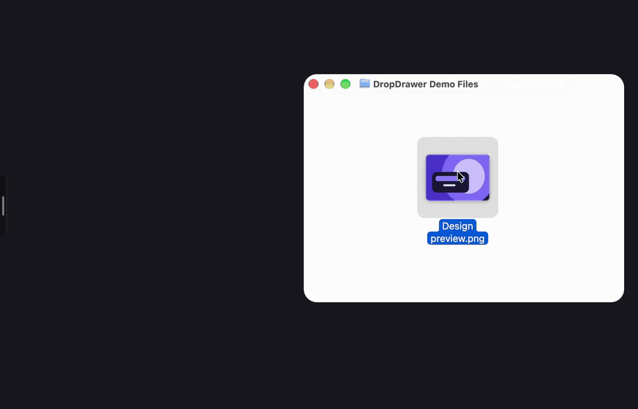
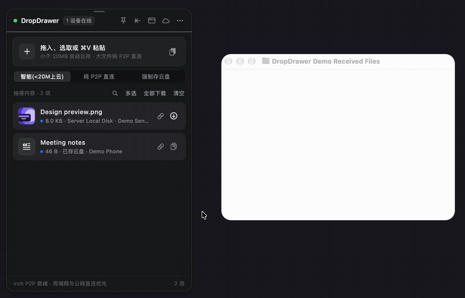
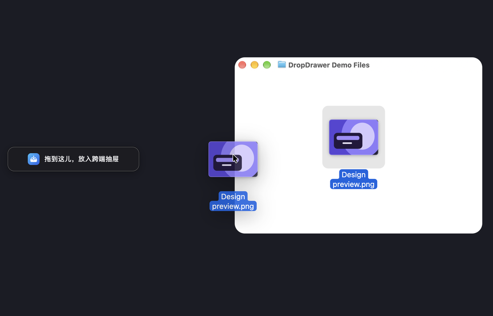
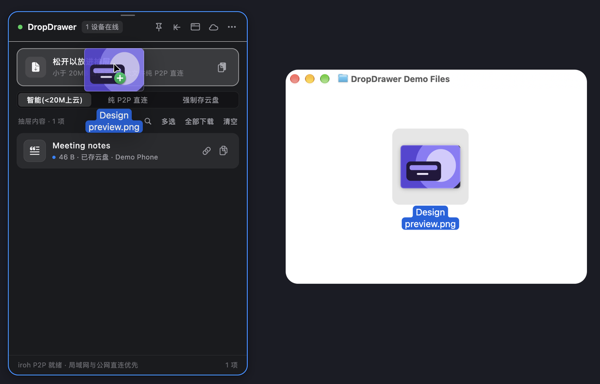
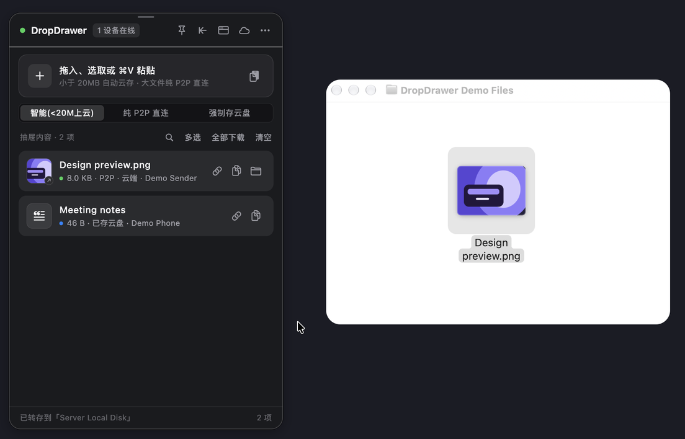
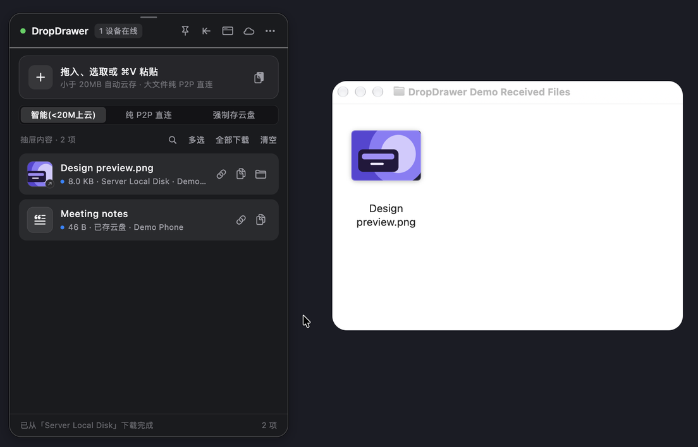
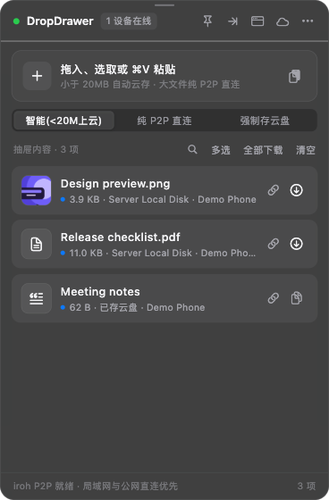
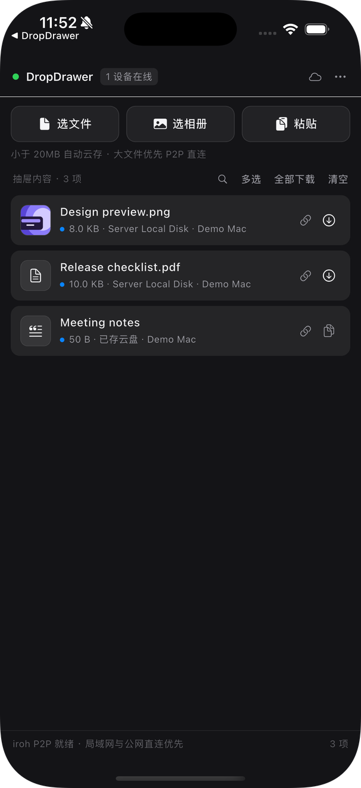

<p align="center">
  
</p>

<h1 align="center">DropDrawer</h1>

<p align="center"><strong>把文件拖进屏幕边缘的抽屉，在另一台设备上取走。</strong></p>

<p align="center">
  <a href="README.md">English</a> |
  简体中文 |
  <a href="README.zh-TW.md">繁體中文</a> |
  <a href="README.ja.md">日本語</a> |
  <a href="README.ko.md">한국어</a>
</p>

<p align="center">
  <a href="https://github.com/StackTao/DropDrawer/releases"></a>
  <a href="https://github.com/StackTao/DropDrawer/actions/workflows/windows-installer.yml"></a>
  <a href="https://github.com/StackTao/DropDrawer/actions/workflows/android-apk.yml"></a>
  <a href="https://github.com/StackTao/DropDrawer/releases"></a>
  <a href="https://github.com/StackTao/DropDrawer/stargazers"></a>
  <a href="LICENSE"></a>
</p>

<p align="center">
  <a href="#操作演示">操作演示</a> ·
  <a href="https://github.com/StackTao/DropDrawer/releases">下载安装包</a> ·
  <a href="#安装客户端">安装客户端</a> ·
  <a href="#自托管服务端">自托管服务端</a> ·
  <a href="docs/ARCHITECTURE.md">架构文档</a> ·
  <a href="https://github.com/StackTao/DropDrawer/issues">问题反馈</a> ·
  <a href="LICENSE">MIT License</a>
</p>

DropDrawer 是一款可自托管的跨平台文件传输与暂存工具。桌面端在屏幕边缘提供随时可打开的抽屉，手机端也能收取和发送文件、图片与文本。设备在线时优先尝试 P2P 直连，已缓存的文件可以通过云盘中转离线取用。需要发给其他人时，可生成浏览器下载链接。

## 操作演示

**拖入并上传.** 从 Finder 拖着文件靠近屏幕边缘，抽屉展开后，在高亮区域松手。开启云端缓存时，上传完成的文件可在其他设备取用。



**在另一台设备取走.** 登录同一账号，点击同步文件旁的下载按钮。动图中可以看到文件出现在接收设备的 Finder 文件夹里。



<details>
<summary>展开查看桌面操作截图</summary>

1. 拖动文件时，屏幕边缘出现引导条。

   

2. 抽屉展开，高亮区域提示松手位置。

   

3. 上传完成后，新文件出现在抽屉列表。

   

4. 下载后，文件出现在接收端文件夹。

   

**展开的桌面抽屉**

<p align="center">
  
</p>

</details>

### iPhone 端

可以快捷选取文件或相册图片，也可以从剪贴板粘贴。同步条目显示在下方，可直接下载或分享。

<p align="center">
  
</p>

## 主要功能

- **桌面贴边抽屉**：macOS 和 Windows 支持拖入文件、拖出到其他应用、跨屏停靠、全局快捷键、剪贴板粘贴和图片预览，也可切换为普通窗口。
- **移动端收发**：Android 和 iOS 支持选取文件或照片、粘贴内容、使用系统分享发送内容，以及将图片保存到相册。Android 支持从系统分享菜单导入，iOS 支持通过「用 DropDrawer 打开」导入文件。
- **P2P 优先**：基于 iroh QUIC，优先尝试局域网或公网直连，必要时可走加密中继。支持断点续传、BLAKE3 完整性校验、送达回执和双向取消。
- **自托管和离线取用**：Rust 服务端负责账号、设备在线状态和抽屉同步，可配置 Google Drive、夸克网盘、百度网盘、S3 兼容存储（含 Cloudflare R2）、WebDAV 或服务器本地磁盘。
- **外链分享**：支持分享单个文件或把多个文件打包。收件人可在浏览器下载，可以设置提取码、有效期、下载次数上限，也可随时撤销链接。

## 安装客户端

| 平台 | 安装包或构建入口 |
| --- | --- |
| macOS（Apple silicon） | 运行 [macOS 打包脚本](scripts/build_macos_release.sh) 生成 `dist/DropDrawer-macOS.dmg`，打开后拖入「应用程序」 |
| Windows（x64） | 在 [Windows installer](https://github.com/StackTao/DropDrawer/actions/workflows/windows-installer.yml) 的成功运行中下载 `DropDrawer-Windows-x64` 构建产物，解压后运行安装程序 |
| Android | 在 [Android APK](https://github.com/StackTao/DropDrawer/actions/workflows/android-apk.yml) 的成功运行中下载 `DropDrawer-Android-APK` 构建产物，解压后安装对应 APK |
| iOS | 在 macOS 上通过原生 SwiftUI（`apple/`）和 Xcode [从源码构建](#从源码构建)，真机安装需要配置签名 |

Windows 和 Android 的构建产物保留 30 天。需要新的安装包时，有权限的仓库成员可以手动触发工作流。

DropDrawer 的发布版本每天自动检查一次更新，有新版时在抽屉里提示，点一下即可更新；macOS 和 Windows 会自动重启到新版本。[各端更新及发版说明](docs/APP_UPDATES.md)

### 第一次传输

1. 启动一个 [DropDrawer 服务端](#自托管服务端)，确保两台设备都能访问它。
2. 在两台设备的客户端填写相同的服务端地址，创建账号后使用同一账号登录。
3. 在桌面端将文件拖入抽屉，或在移动端选择文件。在另一台设备打开抽屉并下载。

如果接收设备需要在发送设备离线时取用文件，请先开启云端缓存，并确保文件已上传到所选存储。

## 自托管服务端

在仓库根目录执行以下任一方式。Docker Compose 会使用 `deploy/data/server` 保存数据，直接运行则默认使用 `./data`。

```bash
cp -n .env.example .env
docker compose --env-file .env -f deploy/docker-compose.yml up -d --build

curl -fsS http://localhost:8080/health
```

也可运行 `cargo run --bin dropdrawer-server` 启动本地开发实例。局域网中的其他设备填写运行服务端的主机地址，例如 `http://192.168.1.10:8080`。

未设置 `DROPDRAWER_JWT_SECRET` 时，服务端会在首次启动时生成随机密钥并保存在数据库旁的 `jwt_secret` 文件中；也可以自行设置足够长的随机值。所需账号都创建好后，请设置 `DROPDRAWER_ALLOW_REGISTRATION=false` 关闭注册。生产部署请使用支持 WebSocket 升级的 HTTPS 反向代理。大文件传输需关闭代理缓冲，并按实际需求调整上传大小上限。外链下载要求收件人能够访问服务端。[生产 Compose 模板](deploy/compose.baota.yml) · [架构文档](docs/ARCHITECTURE.md)

按 [Google 登录配置指南](docs/GOOGLE_SIGN_IN.md) 启用 Google 登录。在各设备使用同一 Google 账号即可访问同一个抽屉。

### 管理控制台

设置 `DROPDRAWER_ADMIN_TOKEN` 后访问服务器的 `/admin`，即可管理用户、存储、登录、文件保留和分享策略。管理员密钥、SMTP、存储配额、Google 登录和反向代理配置见[服务端环境变量](docs/CONFIGURATION.md)。

## 从源码构建

准备 Rust stable 和 Flutter stable。macOS 与 iOS 需要 Xcode，Windows 和 Android 可以使用上表中的 GitHub Actions 工作流。

### macOS

```bash
./scripts/build_macos_p2p.sh
(cd app && flutter pub get --enforce-lockfile && flutter run -d macos)
```

运行 `./scripts/build_macos_release.sh` 打包 DMG，或加上 `--install` 更新本机「应用程序」中的 DropDrawer。使用全局快捷键时，可按系统提示授予辅助功能和输入监控权限。

### iOS（原生 SwiftUI）

```bash
./scripts/build_apple_p2p.sh
(cd apple && xcodegen generate)
```

在 Xcode 中打开生成的 `apple/DropDrawer.xcodeproj`，选择 `DropDrawerIOS` Scheme 即可在模拟器或配置签名后的真机运行（含系统「分享 → DropDrawer」扩展）。

> 如需旧版 Flutter iOS 兼容构建，仍可使用 `./scripts/build_ios_p2p.sh` 与 `app/ios/`。

## 项目结构与贡献

| 路径 | 用途 |
| --- | --- |
| [app](app) | Flutter 桌面端（macOS / Windows）与 Android 客户端及平台原生集成 |
| [apple](apple) | 原生 Swift / SwiftUI iOS 客户端（`DropDrawerIOS`、`DropDrawerShareExtension`、`DropDrawerCore`） |
| [crates/server](crates/server) | Axum、SQLite、WebSocket、存储适配器和外链下载 |
| [crates/p2p-core](crates/p2p-core) | iroh QUIC 传输核心及原生 FFI |
| [crates/protocol](crates/protocol) · [crates/p2p-cli](crates/p2p-cli) | 共享协议和 P2P 调试工具 |
| [deploy](deploy) · [scripts](scripts) | 容器部署、安装包和平台构建脚本 |

欢迎在 [GitHub Issues](https://github.com/StackTao/DropDrawer/issues) 反馈问题或提交功能建议。报告问题时，请附上平台、版本和复现步骤。提交代码前，请按 [工程指南](AGENTS.md) 运行相关检查。

```bash
cargo test --workspace
(cd app && flutter analyze && flutter test)
(cd apple/DropDrawerCore && swift test)
```

如需独立验证 P2P，可用 `cargo run --bin dropdrawer-p2p-cli -- seed ./sample.zip` 生成传输票据，再在另一端运行 `cargo run --bin dropdrawer-p2p-cli -- pull '<TICKET_JSON>' ./received.zip`。

欢迎到 [LINUX DO 社区](https://linux.do/) 交流。

## Star 趋势

<a href="https://www.star-history.com/?repos=StackTao%2FDropDrawer&amp;type=date">
  <picture>
    <source media="(prefers-color-scheme: dark)" srcset="https://api.star-history.com/svg?repos=StackTao/DropDrawer&amp;type=Date&amp;theme=dark" />
    
  </picture>
</a>

## 许可证

DropDrawer 采用 [MIT License](LICENSE)。
