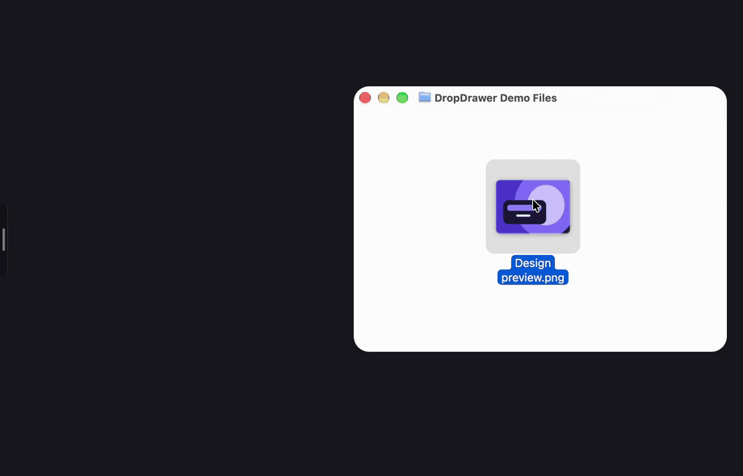
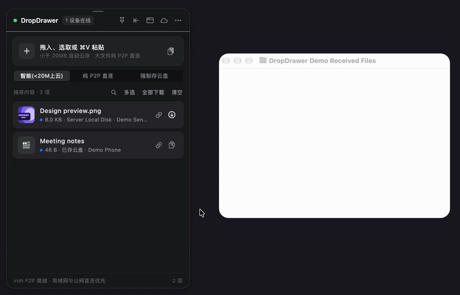
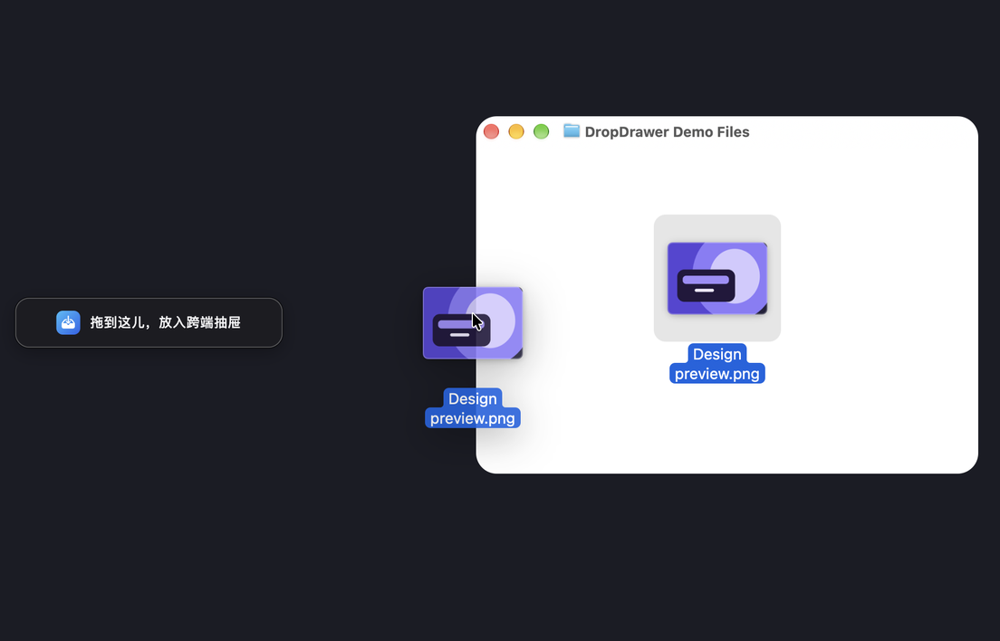
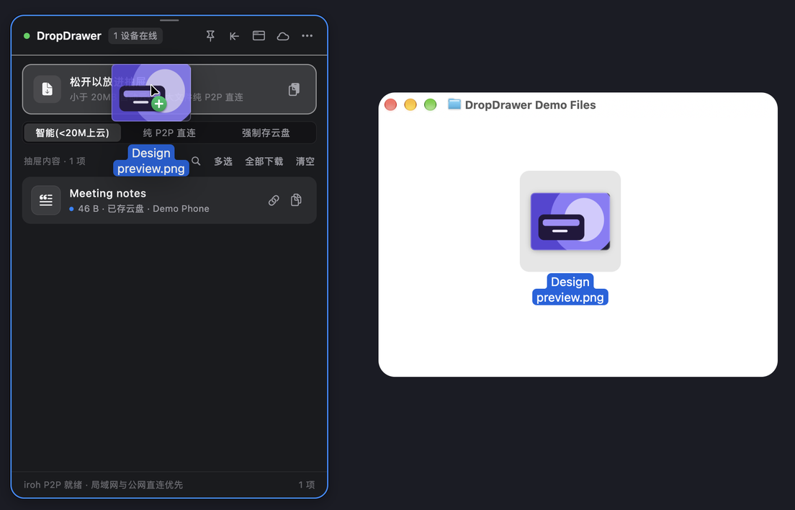
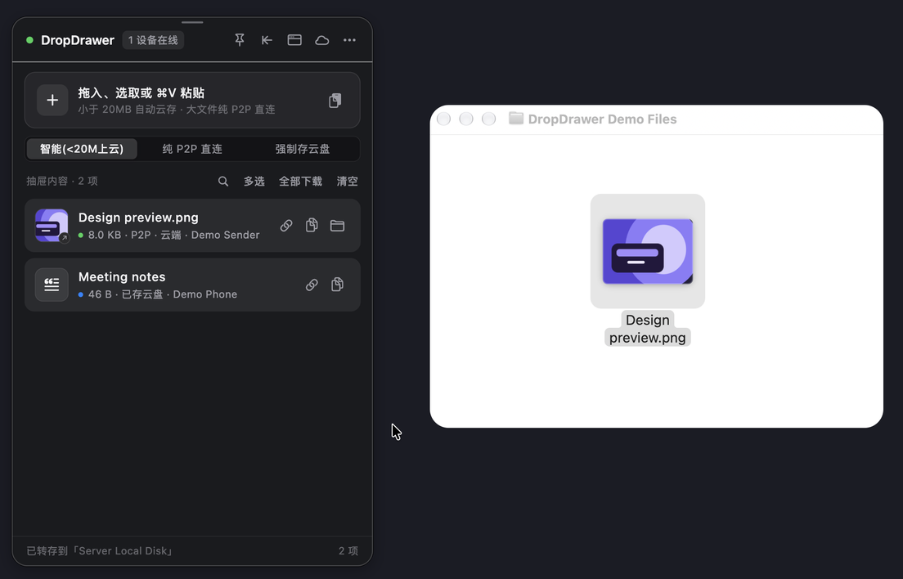
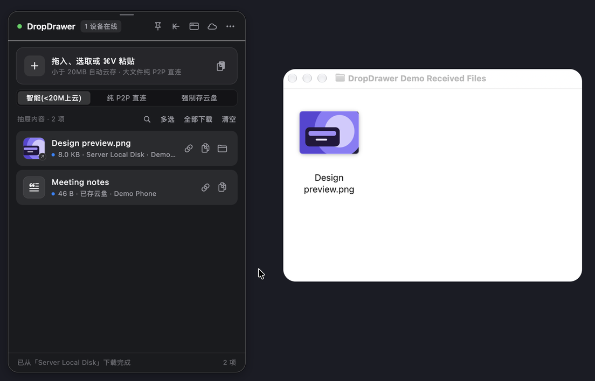
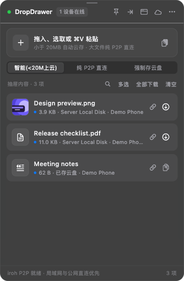
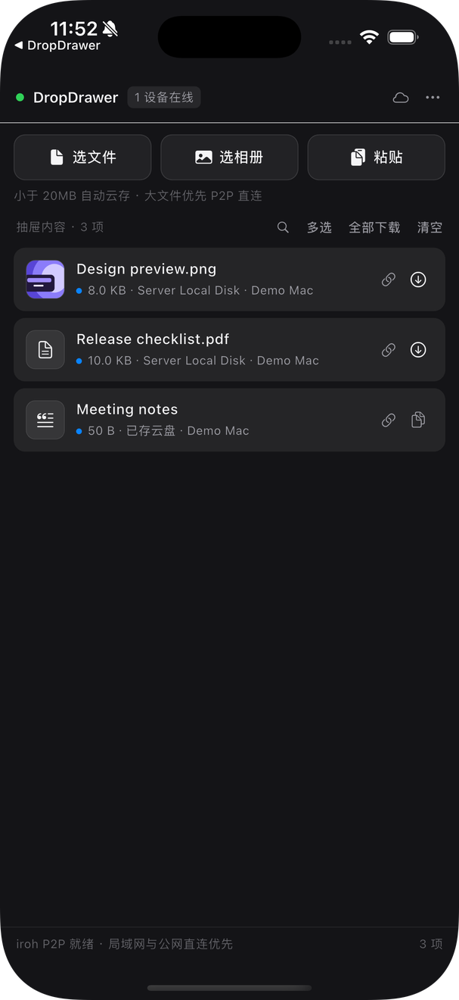

<p align="center">
  
</p>

<h1 align="center">DropDrawer</h1>

<p align="center"><strong>把檔案拖進螢幕邊緣的抽屜，再從另一台裝置取出。</strong></p>

<p align="center">
  <a href="README.md">English</a> |
  <a href="README.zh-CN.md">简体中文</a> |
  繁體中文 |
  <a href="README.ja.md">日本語</a> |
  <a href="README.ko.md">한국어</a>
</p>

<p align="center">
  <a href="https://github.com/StackTao/DropDrawer/actions/workflows/windows-installer.yml"></a>
  <a href="https://github.com/StackTao/DropDrawer/actions/workflows/android-apk.yml"></a>
  <a href="LICENSE"></a>
</p>

<p align="center">
  <a href="#操作示範">操作示範</a> ·
  <a href="https://github.com/StackTao/DropDrawer/releases">下載安裝套件</a> ·
  <a href="#安裝用戶端">安裝用戶端</a> ·
  <a href="#自行架設伺服器">自行架設伺服器</a> ·
  <a href="docs/ARCHITECTURE.md">架構文件（簡體中文）</a> ·
  <a href="https://github.com/StackTao/DropDrawer/issues">問題回報</a> ·
  <a href="LICENSE">MIT License</a>
</p>

DropDrawer 是一款可自行架設的跨平台檔案傳輸與暫存工具。桌面版在螢幕邊緣提供隨時可開啟的抽屜，行動版也能收發檔案、相片和文字。兩台裝置都在線時，DropDrawer 會優先嘗試 P2P 直連。來源裝置離線時，仍可透過已設定的儲存空間下載快取檔案。你也可以建立分享連結，讓其他人透過瀏覽器下載。

## 操作示範

**拖入並上傳.** 從 Finder 將檔案拖到螢幕邊緣附近。抽屜展開後，在醒目提示區放開。啟用雲端快取時，上傳完成的檔案可在其他裝置取用。



**在另一台裝置取出.** 登入同一個帳號，點選同步檔案旁的下載按鈕。動圖顯示檔案出現在接收裝置的 Finder 資料夾裡。



<details>
<summary>展開查看桌面操作截圖</summary>

1. 拖曳檔案時，螢幕邊緣會出現提示。

   

2. 抽屜展開，醒目提示區顯示放開的位置。

   

3. 上傳完成後，新檔案會出現在抽屜清單。

   

4. 下載後，檔案會出現在接收端的資料夾。

   

**展開的桌面抽屜**

<p align="center">
  
</p>

</details>

### iPhone 版

可快速選取檔案或相簿照片，也可以從剪貼簿貼上。同步項目顯示在下方，可直接下載或分享。

<p align="center">
  
</p>

## 主要功能

- **桌面貼邊抽屜**：在 macOS 和 Windows 上可拖入檔案、拖出至其他應用程式、跨螢幕停靠、使用全域快速鍵與剪貼簿，並預覽圖片。也可切換成一般視窗。
- **行動裝置收發**：Android 和 iOS 支援選取檔案或相片、貼上內容、透過系統分享功能傳送，以及將圖片儲存到相簿。Android 可從系統分享選單匯入，iOS 可透過「用 DropDrawer 開啟」匯入檔案。
- **P2P 優先**：採用 iroh QUIC，優先嘗試區域網路或網際網路直連，必要時使用加密中繼。支援斷點續傳、BLAKE3 完整性驗證、送達回執與雙向取消。
- **自行架設與離線存取**：Rust 伺服器負責帳號、裝置上線狀態和抽屜同步。可搭配 Google Drive、夸克網盤、百度網盤、S3 相容儲存空間（含 Cloudflare R2）、WebDAV 或伺服器本機磁碟。
- **連結分享**：可分享單一檔案，或將多個檔案打包。收件人可在瀏覽器下載。你可以設定提取碼、有效期限與下載次數上限，也能隨時撤銷連結。

## 安裝用戶端

| 平台 | 安裝套件或建置方式 |
| --- | --- |
| macOS（Apple silicon） | 執行 [macOS 打包指令碼](scripts/build_macos_release.sh) 產生 `dist/DropDrawer-macOS.dmg`，開啟後將 DropDrawer 拖進「應用程式」。 |
| Windows（x64） | 從成功執行的 [Windows installer](https://github.com/StackTao/DropDrawer/actions/workflows/windows-installer.yml) 工作流程下載 `DropDrawer-Windows-x64` 建置產物，解壓縮後執行安裝程式。 |
| Android | 從成功執行的 [Android APK](https://github.com/StackTao/DropDrawer/actions/workflows/android-apk.yml) 工作流程下載 `DropDrawer-Android-APK` 建置產物，解壓縮後安裝對應的 APK。 |
| iOS | 在 macOS 上使用 Flutter 和 Xcode [從原始碼建置](#從原始碼建置)。安裝到實體裝置需要設定簽署。 |

Windows 和 Android 的建置產物保留 30 天。具有權限的儲存庫成員可手動執行工作流程，以取得新的安裝套件。

### 第一次傳輸

1. 啟動 [DropDrawer 伺服器](#自行架設伺服器)，確認兩台裝置都能連線。
2. 在兩台裝置輸入相同的伺服器位址。建立帳號後，使用同一個帳號登入兩台裝置。
3. 在桌面版將檔案拖進抽屜，或在行動版選取檔案。接著在另一台裝置開啟抽屜並下載。

若要在來源裝置離線時仍可下載檔案，請啟用雲端快取，並確認檔案已上傳至選定的儲存空間。

## 自行架設伺服器

在儲存庫根目錄執行 Docker Compose 或 Cargo。Docker Compose 預設將資料儲存在 `deploy/data/server`，直接執行伺服器則使用 `./data`。

```bash
DROPDRAWER_JWT_SECRET="$(openssl rand -hex 32)" \
  docker compose -f deploy/docker-compose.yml up -d --build

curl -fsS http://localhost:8080/health
```

如需在本機開發，可執行 `cargo run --bin dropdrawer-server`。在相同區域網路上的其他裝置輸入伺服器主機的位址，例如 `http://192.168.1.10:8080`。

正式部署時，請設定獨立且能在重新啟動後沿用的 `DROPDRAWER_JWT_SECRET`，並使用支援 WebSocket 升級的 HTTPS 反向代理。傳輸大型檔案時，需關閉代理緩衝，並依實際需求調整上傳大小上限。使用分享連結下載的收件人須能連線至伺服器。[正式環境 Compose 範本](deploy/compose.baota.yml) · [架構文件（簡體中文）](docs/ARCHITECTURE.md)

## 從原始碼建置

請準備穩定版 Rust 和 Flutter。建置 macOS 和 iOS 版本需要 Xcode。Windows 和 Android 可使用上表的 GitHub Actions 工作流程。

### macOS

```bash
./scripts/build_macos_p2p.sh
(cd app && flutter pub get --enforce-lockfile && flutter run -d macos)
```

執行 `./scripts/build_macos_release.sh` 產生 DMG，或加上 `--install` 更新本機「應用程式」中的 DropDrawer。使用全域快速鍵時，可依系統提示授予輔助使用及輸入監控權限。

### iOS

```bash
./scripts/build_ios_p2p.sh
(cd app && flutter pub get --enforce-lockfile && flutter build ios --simulator --no-codesign)
```

若要在實體裝置上測試，請在 Xcode 中開啟 `app/ios/Runner.xcworkspace`，設定簽署後執行。

## 專案結構與貢獻

| 路徑 | 用途 |
| --- | --- |
| [app](app) | Flutter 用戶端，以及 macOS、Windows、iOS 和 Android 原生整合 |
| [crates/server](crates/server) | Axum、SQLite、WebSocket、儲存介面和分享連結下載 |
| [crates/p2p-core](crates/p2p-core) | iroh QUIC 傳輸核心與原生 FFI |
| [crates/protocol](crates/protocol) · [crates/p2p-cli](crates/p2p-cli) | 共用通訊協定與 P2P 除錯工具 |
| [deploy](deploy) · [scripts](scripts) | 容器部署、安裝套件及各平台的建置指令碼 |

歡迎透過 [GitHub Issues](https://github.com/StackTao/DropDrawer/issues) 回報問題或提出功能建議。回報問題時，請附上平台、版本及重現步驟。提交程式碼前，請依照[工程指南（簡體中文）](AGENTS.md)執行相關檢查。

```bash
cargo test --workspace
(cd app && flutter analyze && flutter test)
```

若要獨立測試 P2P，請執行 `cargo run --bin dropdrawer-p2p-cli -- seed ./sample.zip` 產生傳輸票據，再於接收端執行 `cargo run --bin dropdrawer-p2p-cli -- pull '<TICKET_JSON>' ./received.zip`。

## 授權

DropDrawer 採用 [MIT 授權條款](LICENSE)。
